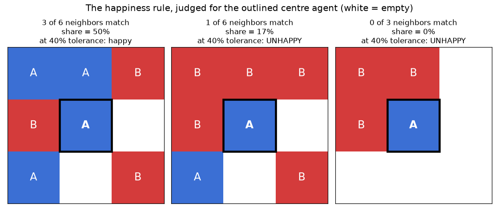
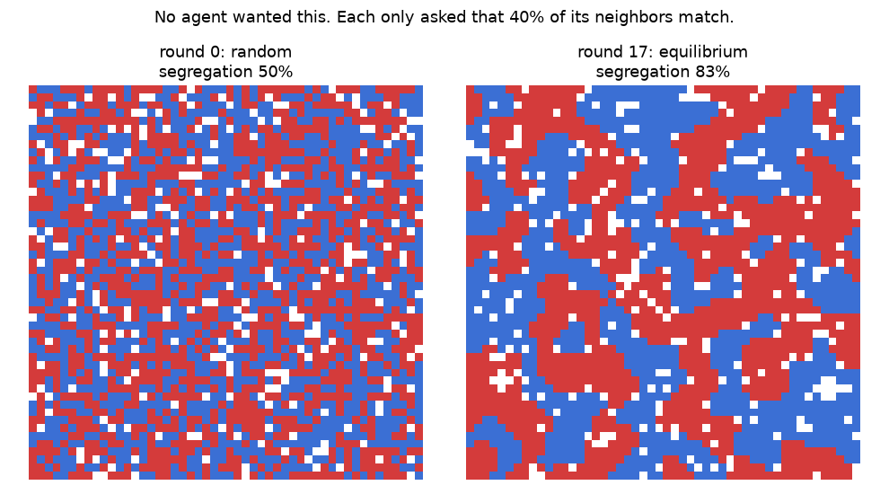
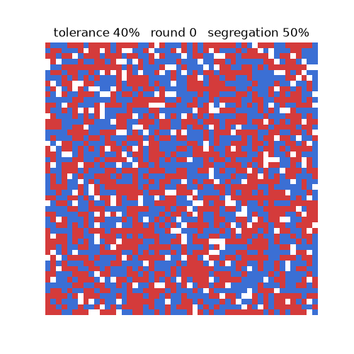
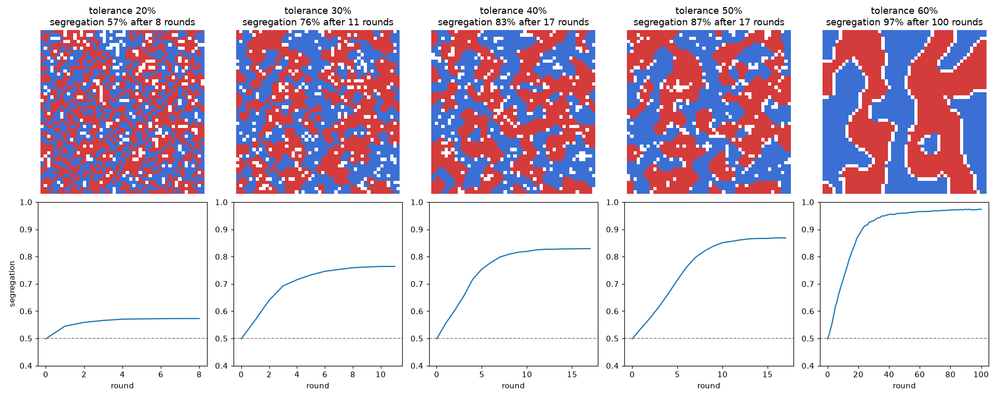

# Schelling's Segregation Model, Explained

A walkthrough of what the model says, what the code does, and what the result means. Written to be readable months from now without re-deriving anything. Code lives in [`segregation_simulator.py`](segregation_simulator.py); every figure here is produced by running it.

---

## 1. The question the model answers

Look at a segregated city and the natural explanation is that people wanted it that way — that segregation is the sum of a lot of strongly held preferences about who to live near.

Thomas Schelling asked whether that inference actually holds. Suppose nobody has a strong preference. Suppose every person is perfectly content to be a minority in their own neighborhood, and would only move if they became *extremely* isolated. What does a city made of such people look like after everyone has settled?

The answer is the point of the model, and it is not the obvious one.

---

## 2. The rules, in full

The entire model is four rules. There is nothing else in it — no income, no policy, no history, no discrimination beyond the single number below.

1. **A grid.** Each cell is empty, or holds an agent of type A or type B. The two types are deliberately meaningless — colors on a board, nothing more.
2. **Local vision.** An agent sees only the eight cells surrounding it. It knows nothing about the grid as a whole.
3. **A happiness rule.** An agent is *happy* if at least `tolerance` of its occupied neighbors are its own type. Otherwise it is *unhappy*.
4. **Movement.** Each round, every unhappy agent relocates to a randomly chosen empty cell. Rounds repeat until nobody is unhappy.

The one number that matters is `tolerance`. Read it as: *"the minimum share of my neighbors I need to be like me before I'll stay."*

Note what `tolerance` is **not**. It is not a hatred threshold or a preference for segregation. At `tolerance = 0.3`, an agent is happy being outnumbered more than two to one. It would only pack up if its neighborhood became more than 70% the other type.

### The happiness rule on cases you can count by hand



Three details, all visible above:

- **Empty cells never count.** The share is computed over *occupied* neighbors only. In the right-hand panel the agent has five empty neighbors and three occupied ones, so the denominator is 3, not 8.
- **Edge and corner agents have fewer neighbors.** The grid does not wrap around. A corner agent judges its situation on 3 neighbors, and 1 of 3 is a perfectly valid 33%.
- **An agent with no occupied neighbors at all is treated as content.** There is no share to compute, so it stays put. This is a modeling choice, not a deep truth — it just avoids dividing by zero.

In code, that rule is these few lines:

```python
def same_type_share(grid, row, col):
    me = grid[row][col]
    occupied = [n for n in neighbors(grid, row, col) if n != EMPTY]
    if not occupied:
        return None
    same = sum(1 for n in occupied if n == me)
    return same / len(occupied)


def is_unhappy(grid, row, col, tolerance):
    share = same_type_share(grid, row, col)
    return share is not None and share < tolerance
```

---

## 3. How a round works

`step()` runs one round in two distinct phases:

```python
# Phase 1: survey. Find everyone who is unhappy, and every vacancy.
# Phase 2: move. Relocate the unhappy agents into the vacancies.
```

**Why two phases and not one?** If agents moved the instant they were found unhappy, an early mover would reshape the neighborhood of an agent that had not been examined yet. The final grid would then depend on the order the loop happened to scan the cells in — top-left first, say — which is an artifact of the program, not a feature of the model. Surveying everyone against the same frozen snapshot removes that.

**Two other choices worth knowing:**

- Both the unhappy list and the vacancy list are **shuffled** before pairing, so an agent gets no advantage from sitting near the top-left of the grid.
- Movers are paired with vacancies using `zip`, which **stops at the shorter list**. If 400 agents are unhappy but only 250 cells are empty, 250 move and the remainder wait for the next round. That is a housing-supply constraint, and it emerges from the data structures rather than being coded explicitly.

Agents move to a **random** empty cell — not to a better one. They are not optimizing, not searching, not comparing options. This matters: the sorting you are about to see cannot be attributed to clever agents, because these agents are as dumb as it is possible to be while still following rule 4.

---

## 4. The measurement

One number summarizes any grid:

```python
segregation(grid)  # mean same-type-neighbor share, across all agents
```

Read it as **"the typical agent's neighborhood is X% people like them."**

The scale has two anchors worth memorizing:

- **~50%** — a randomly mixed grid. Half your neighbors are yours, half aren't. This is what "no segregation" looks like, and it is where every run starts.
- **100%** — perfect sorting, every agent surrounded entirely by its own type.

---

## 5. The result



Left: the random starting grid, 50% segregated. Right: the same grid 17 rounds later, once nobody wants to move — 83% segregated. Tolerance was 40%, meaning **not one agent on that board asked for a majority of its own type.** They asked to not be outnumbered worse than 3-to-2. What they collectively produced is a map of visibly separated territories.

The animation shows the intervening rounds:



And the round-by-round numbers, printed by `trace()`:

```
--- tolerance 40%: agent wants >= 40% of its neighbors to be its own type ---
round  unhappy agents  segregation
    0             696         50%   <- random start
    1             505         56%
    2             404         60%
    3             302         66%
    4             175         72%
    5             117         75%
  ...
   17               0         83%   <- nobody wants to move: equilibrium
```

Two things to notice in that table.

**Unhappiness falls the whole way down.** The process is not a struggle; it resolves. Each round leaves fewer agents dissatisfied than the one before.

**It ends at zero, and that is permanent.** When no agent is unhappy, no agent moves, so the grid is frozen — this is an *equilibrium*. Segregation here is not a passing phase on the way to something better. It is the stable resting state, and it is stable precisely because everyone is content. There is nobody left with a reason to act.

---

## 6. The tolerance sweep

Run the same starting grid at five different tolerances:



| Tolerance | Meaning for one agent | Final segregation |
|-----------|----------------------|-------------------|
| 20% | happy outnumbered 4-to-1 | 57% |
| 30% | happy outnumbered 7-to-3 | 76% |
| 40% | happy outnumbered 3-to-2 | 83% |
| 50% | wants an even split | 87% |
| 60% | wants a modest majority | 97% |

The interesting rows are the ones near the top, not the bottom. That 60% produces near-total segregation is unsurprising — those agents actively want a majority. The finding is the **30% row**: agents entirely comfortable being a small minority nonetheless generate a grid where the typical neighborhood is three-quarters one type.

Also note where the jump happens. Going from 20% to 30% moves the outcome 19 points; going from 50% to 60% moves it 10. The system is most sensitive in the range of the mildest preferences.

---

## 7. The actual insight

**Macro patterns are not scaled-up micro preferences.**

The tempting reading of a segregated map is that it reflects segregationist people. This model breaks that inference by producing the map without the people: no agent in the code prefers segregation, no agent can even perceive segregation — each one sees eight cells. Yet segregation is reliably what the system produces.

The mechanism is a feedback loop that no individual is aware of. One agent leaves a neighborhood, which tips the balance for a neighbor, who leaves, which tips it further. Meanwhile the mover's arrival somewhere else tips *that* neighborhood in the opposite direction. Small local adjustments compound into large global structure, and the individuals doing the adjusting have neither the intent nor the visibility to notice.

Two consequences that generalize past this model:

**You cannot read preferences off outcomes.** Observing a segregated city tells you very little about how intolerant its residents are. The same 83% map is consistent with 40% tolerance, and it would be a mistake to conclude from the map alone that anyone is strongly prejudiced.

**Intervening on stated preferences may not help.** If everyone's tolerance dropped from 40% to 30% — a real shift toward openness — segregation would fall from 83% to 76%, not to 50%. The pattern is generated by the *dynamics*, so a fix aimed only at the *attitudes* leaves most of it intact.

---

## 8. Things to try

Every one of these is a small edit to `segregation_simulator.py`:

- **`trace(0.2)` versus `trace(0.6)`.** Watch the phase change. At 20% the grid barely leaves its random start; at 60% it sorts almost completely.
- **Change `empty_share` in `make_grid`.** More vacancies mean unhappy agents always find somewhere to go, so the grid sorts faster. Set it very low and watch the system struggle to reach equilibrium at all — a housing shortage traps people in neighborhoods they want to leave.
- **Give the two types different tolerances.** Currently both are equally picky. Make type B need 60% while type A needs 30% and see which group ends up more concentrated. (Hint: it will not be only B.)
- **Let agents choose the best vacancy instead of a random one.** Does purposeful searching increase segregation, or does it reach the same place faster?
- **Add a maximum tolerance** — an agent unhappy if *more* than 80% of neighbors match, i.e. one who actively wants some diversity. Does a preference for mixing survive the dynamics, or does the loop overwhelm it?

---

## 9. What this model deliberately leaves out

Worth stating plainly, because a model's value comes partly from knowing where it stops:

- No income, prices, or housing markets. Everyone can afford to live anywhere.
- No discrimination in the moving process. No agent is refused a cell.
- No history, institutions, schools, or policy.
- Agents are identical within type and never change their tolerance.

These omissions are the point rather than a shortcoming. The model exists to establish one thing: that segregation *can* arise with none of these factors present. It does not claim they are unimportant in real cities — only that they are not strictly necessary to produce the pattern.
